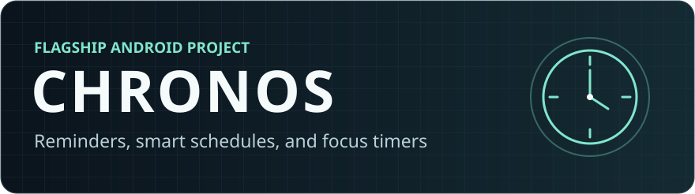

# Chronos

Chronos is Naveen C M’s flagship Android project. It brings reminders, schedules, and focus timers into one app.

| Feature | How it works |
| --- | --- |
| Reminders | Chronos saves reminders in Room, schedules them with Android’s alarm APIs, and reschedules future reminders after a reboot. |
| Smart schedules | Review the time and label before opening Android Clock. For a specific date, set an in-app alarm or open an event draft in Android Calendar. |
| Focus timers | Start 15-, 25-, or 45-minute countdowns in Android Clock. |

Built with Kotlin, Jetpack Compose, Room, and AlarmManager for Android 8.0 and later.

The source preview is currently private. A public APK is pending.

[Back to Naveen’s GitHub profile](https://github.com/itsnaveencm)
