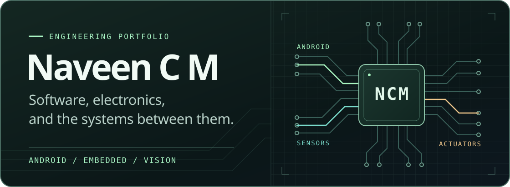

# Naveen C M

I’m an Electronics and Communication Engineering graduate working across native Android, embedded systems, and computer vision. I build applications and prototypes that connect software to the physical world.

## KTU Calc

**An installable academic planner for APJ Abdul Kalam Technological University students.**

KTU Calc combines credit-weighted grade calculations with target planning, a percentage converter, and calculation history stored on the device. The app runs without an account and uses a service worker for offline access.

**[Launch KTU Calc](https://itsnaveencm.github.io/ktu-calculator/)** · [Read the source](https://github.com/itsnaveencm/ktu-calculator)

`JavaScript` · `HTML` · `CSS` · `Service Worker`

## Android and hardware projects

| Project | Engineering focus |
| --- | --- |
| **CHRONOS** · In development | A native Android assistant exploring scheduling, event-driven reminders, local storage, and user-controlled integrations. |
| **Autonomous Water Surface Cleaning Boat** | A catamaran-style prototype for collecting floating waste. It combines GPS and IMU navigation support, onboard sensing, computer-vision detection, and manual control. |
| **Vision Arm** | A robotic-arm prototype designed to identify waste categories and support automated sorting. |

## Tools

**Android** · Kotlin, Android SDK  
**Embedded and prototyping** · Arduino, Raspberry Pi, MATLAB  
**Web and version control** · HTML, CSS, JavaScript, Git
