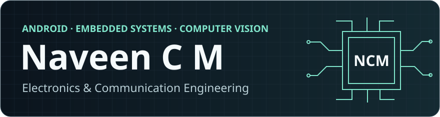
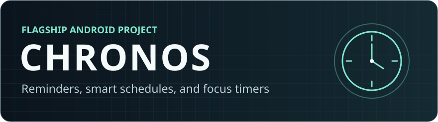

I build native Android apps and electronics prototypes. My work spans background scheduling, offline web apps, and computer vision for hardware.

## Flagship

Chronos keeps reminders in Room and restores upcoming alarms after a reboot. You can review a schedule before sending it to Android Clock, open a date-specific event in Calendar, or start a 15-, 25-, or 45-minute focus timer.

**Kotlin · Jetpack Compose · Room · AlarmManager**  
Version 1.0 source preview prepared. Public download pending.

## More projects

| Project | What it does |
| :--- | :--- |
| **[NEXTPOST](https://github.com/itsnaveencm/NEXTPOST)** | Android project for tracking recruitment notices, exams, and deadlines. |
| **[KTU Calc](https://itsnaveencm.github.io/ktu-calculator/)** · [Source](https://github.com/itsnaveencm/ktu-calculator) | Offline-ready academic planner for KTU students. Calculate SGPA and credit-weighted CGPA, or work backward from a target grade. |
| **Autonomous Water Surface Cleaning Boat** | Catamaran prototype for collecting floating waste using GPS, an IMU, and computer vision. |
| **Vision Arm** | Robotic-arm prototype designed to identify and sort waste by category. |
